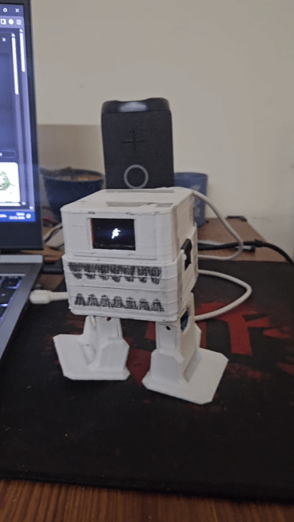

# 🤖 Dancing_Robo (Mike Wazowski)

An interactive, sound-reactive dancing bipedal robot powered by an **ESP32**. **Dancing_Robo** listens to surrounding music via an amplified electret microphone (MAX9814), reacts with dynamic servo-driven dance routines, and expresses emotions through smooth animated eyes on a 128x64 OLED display.

## 🎥 Demo Preview



## ✨ Features

* **Sound-Reactive Dancing:** Uses a **MAX9814** auto-gain microphone module to detect beats and music thresholds (`MUSIC_START_THRESHOLD` / `MUSIC_STOP_THRESHOLD`), automatically transitioning between idle animations and dance routines.

* **Expressive OLED Face:** Renders 60+ custom `PROGMEM` bitmap frames (`eyes0` – `eyes62+`) on an **SSD1306 128x64 I2C OLED** display for blinking, happy, and dancing expressions.

* **4-DOF Bipedal Kinematics:** Driven by 4 micro servos (`ESP32Servo`) controlling left/right hips and left/right feet for walking, side-stepping, moonwalking, and rhythmic swaying.

* **Calibration Utility Included:** Includes a dedicated `servo_fix` sketch to center all servos to $90^\circ$ before assembling the 3D-printed limbs.

* **3D Printable Chassis:** Complete `.stl` files included in the `/PrintFiles` directory.

## 🛠️ Hardware Components (Bill of Materials)

| Qty | Component | Description / Notes | 
| ----- | ----- | ----- | 
| **1** | **ESP32 Development Board** | ESP32-WROOM-32 (30-pin or 38-pin DevKit V1) | 
| **1** | **0.96" OLED Display** | 128x64 resolution, SSD1306 driver, I2C interface | 
| **1** | **MAX9814 Microphone Module** | Electret microphone amplifier with Automatic Gain Control (AGC) | 
| **4** | **SG90 / MG90S Micro Servos** | 180-degree servos (MG90S metal gear recommended for durability) | 
| **1** | **Battery Pack & Buck Converter** | 2S LiPo (7.4V) + LM2596/MP1584 step-down to **5V** (or 18650 shield) | 
| **1** | **Power Switch** | Mini SPST rocker or slide switch | 
| **1 set** | **3D Printed Parts** | Head, Body, Left/Right Legs, Left/Right Feet (see `/PrintFiles`) | 
| **Misc** | **Jumper Wires & Screws** | Female-to-Female DuPont wires & M2 mounting screws (included with servos) | 

## 🔌 Wiring & Pinout Diagram

> **⚠️ Power Warning:** Do **not** power the 4 servos directly from the ESP32's `3.3V` or `VIN` pin when connected only via USB. Use an external **5V (2A+)** power supply/battery for the servos and connect all Grounds (`GND`) together.

### 1. OLED Display (SSD1306 I2C)

| OLED Pin | ESP32 Pin | Notes | 
| ----- | ----- | ----- | 
| **VCC** | `3.3V` | Can also use `5V` depending on module regulator | 
| **GND** | `GND` | Common Ground | 
| **SDA** | `GPIO 21` | Default ESP32 I2C Data (`OLED_SDA`) | 
| **SCL** | `GPIO 22` | Default ESP32 I2C Clock (`OLED_SCL`) | 

### 2. MAX9814 Microphone Module

| MAX9814 Pin | ESP32 Pin | Notes | 
| ----- | ----- | ----- | 
| **VDD** | `3.3V` | Use `3.3V` for clean ADC reference | 
| **GND** | `GND` | Common Ground | 
| **OUT** | `GPIO 34` *(or ADC1 pin)* | Analog audio signal (`MIC_PIN` — verify pin in `Dancing_Robo.ino`) | 
| **GAIN** | `GND` or `VDD` *(Optional)* | Leave floating for 60dB, connect to `VDD` for 40dB, `GND` for 50dB | 
| **AR** | *Unconnected* | Attack/Release ratio (default 1:4000) | 

### 3. Servo Motors (`ESP32Servo`)

*(Check exact servo pin assignments at the top of `Dancing_Robo.ino` before final assembly)*

| Joint Position | Servo Signal Pin | Power (`VCC`) | Ground (`GND`) | 
| ----- | ----- | ----- | ----- | 
| **Left Hip (YL)** | `GPIO 13` / `GPIO 25` *(check sketch)* | External `5V` | Common `GND` | 
| **Right Hip (YR)** | `GPIO 12` / `GPIO 26` *(check sketch)* | External `5V` | Common `GND` | 
| **Left Foot (RL)** | `GPIO 14` / `GPIO 27` *(check sketch)* | External `5V` | Common `GND` | 
| **Right Foot (RR)** | `GPIO 27` / `GPIO 33` *(check sketch)* | External `5V` | Common `GND` | 

## 📂 Repository Structure

```
Dancing_Robo/
├── Dancing_Robo.ino        # Main firmware (Audio detection, OLED animations, dance choreography)
├── PrintFiles/             # 3D printable STL files for head, body, legs, and feet
├── media/                  # Demo GIF and project photos
├── servo_fix/              # Utility sketch to zero/center servos to 90° before assembly
└── README.md               # Project documentation

```

## 🚀 Setup & Installation

### 1. 3D Printing

1. Open the `.stl` files inside the **`PrintFiles/`** folder in your slicer (Cura, PrusaSlicer, Bambu Studio).

2. Recommended print settings:

   * **Material:** PLA or PETG

   * **Infill:** 15% – 20%

   * **Layer Height:** 0.2 mm

### 2. Arduino IDE & Libraries

1. Install the **ESP32 Board Package** by Espressif Systems via the Arduino Boards Manager.

2. Install the following required libraries via **Sketch > Include Library > Manage Libraries**:

   * **Adafruit GFX Library** by Adafruit

   * **Adafruit SSD1306** by Adafruit

   * **ESP32Servo** by Kevin Harrington / John K. Bennett

### 3. Servo Calibration (Important!)

Before attaching the plastic servo horns to the 3D-printed legs and feet:

1. Open `servo_fix/servo_fix.ino` and upload it to your ESP32.

2. Connect your 4 servos—they will automatically move to their $90^\circ$ **neutral center position**.

3. While powered at $90^\circ$, attach the legs and feet straight, then secure them with the center screws.

### 4. Option A: Flashing via Arduino IDE (Source Code)

1. Open `Dancing_Robo.ino` in the Arduino IDE.

2. Verify your pin definitions (`MIC_PIN`, servo pins, and `SCREEN_ADDRESS` `0x3C`).

3. Adjust the sound sensitivity constants if needed for your room's ambient noise:

   ```cpp
   const int MUSIC_START_THRESHOLD = 3000;      // Sound level required to trigger dancing
   const int MUSIC_STOP_THRESHOLD  = 1600;      // Sound level below which robot returns to idle
   const unsigned long STARTUP_IDLE_MS = 15000; // Initial idle delay after boot (15s)
   ```

4. Select **ESP32 Dev Module** and click **Upload**.

### 5. Option B: Flashing Pre-Compiled Binary (`esptool`)

If you already have the merged `.bin` firmware file (`Dancing_Robo.ino.merged.bin`), you can flash it directly via Command Prompt/Terminal:

1. **Open CMD/Terminal in your firmware folder** (ensure your current directory contains the `.bin` file).

2. **Install `esptool`** (if not already installed):

   ```bash
   python -m pip install esptool
   ```

3. **Find your ESP32 COM port:**

   ```bash
   python -m esptool --list-ports
   ```

   *(For example, assume your ESP32 is connected to `COM3`.)*

4. **Flash the merged BIN** (flashes complete firmware starting at address `0x0`):

   ```bash
   python -m esptool --chip esp32 --port COM3 --baud 460800 write_flash 0x0 Dancing_Robo.ino.merged.bin
   ```

5. **Verify:** After flashing, you should see a successful write and hash verification message.

> **Optional — Erase Old Firmware First:**
> If you want to erase the existing flash memory before uploading, run:
>
> ```bash
> python -m esptool --chip esp32 --port COM3 erase_flash
> ```
>
> Then run the flashing command again. *(Erasing first is optional; the merged firmware can normally be flashed directly.)*

#### Quick Copy-Paste Flash Command

```bash
python -m esptool --chip esp32 --port COM3 --baud 460800 write_flash 0x0 Dancing_Robo.ino.merged.bin
```

## 📄 License

This project is open-source and available under the [MIT License](LICENSE).